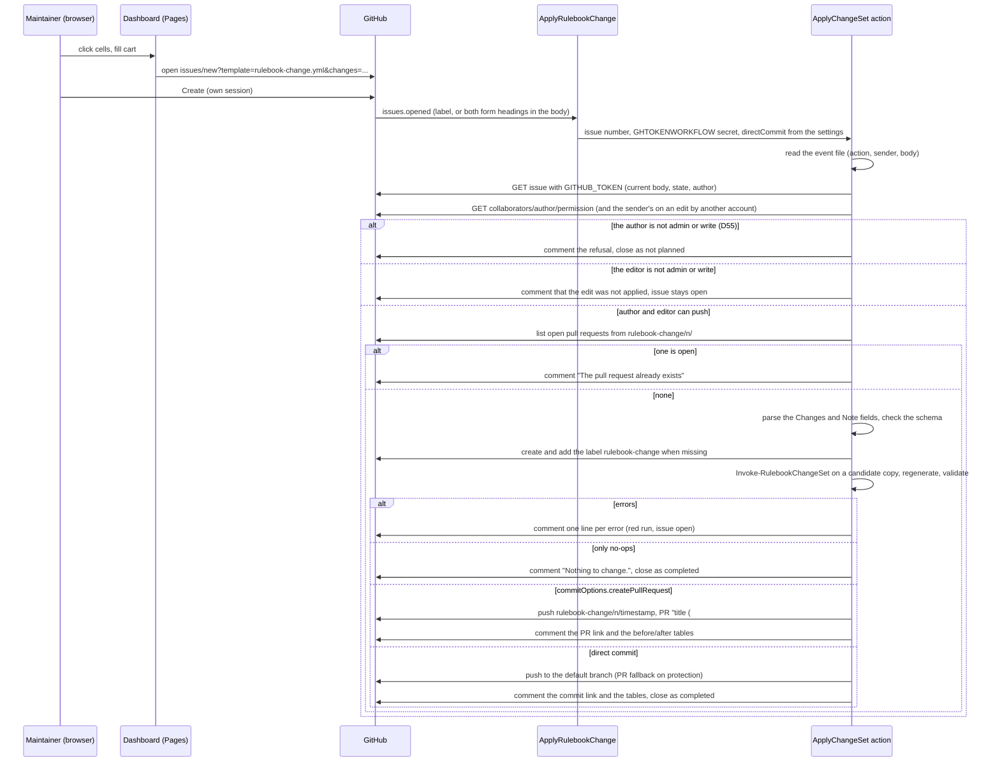

# Rulebook dashboard

Design of the dashboard an organization gets with its rulebook repository: a Hugo site, published next to the endpoints, that shows the matrix of diagnostic ids by level and stage, and a write path that turns clicks into a pull request without any infrastructure beyond GitHub. Contributor document; the user-facing page will be `docs/dashboard.md` in `template/docs/` (WP14), copied to `ALCops/rulebook` by the deploy.

> **Status:** target design after the interview of 2026-10-03 (D31 to D37). The site, the data file, the change set schema and the issue form are implemented by [WP14](https://github.com/ALCops/rulebook-engine/issues/16) (D54, sections 4 to 7); the apply workflow of section 8 is [WP15](https://github.com/ALCops/rulebook-engine/issues/17).

---

## Contents

1. [Problem and constraints](#1-problem-and-constraints)
2. [Interview outcome](#2-interview-outcome)
3. [Why this shape](#3-why-this-shape)
4. [Site](#4-site)
5. [Data contract](#5-data-contract)
6. [Change set](#6-change-set)
7. [Issue form](#7-issue-form)
8. [Apply workflow](#8-apply-workflow)
9. [Update behaviour for site files](#9-update-behaviour-for-site-files)
10. [Exposure](#10-exposure)
11. [Open questions](#11-open-questions)
12. [References](#12-references)

---

## 1. Problem and constraints

An organization edits its rulebook through JSON files: `overrides.json`, the quarantine files, `Rulebook-Settings.json`. Engineers manage; a team lead or consultant who owns the rulebook does not want to hand-edit JSON. The wish is a dashboard over the matrix (628 ids in the shipped set, 4 levels, 3 stages, 12 endpoints) where a maintainer clicks a cell and the change lands in the repository.

Constraints, in priority order:

1. **GitHub only.** No database, no hosted service, no third-party component an organization has to run. A custom username and password is rejected outright.
2. **No token handling by the user.** A pasted personal access token is a hurdle for the people the dashboard is for.
3. **Click, do not edit.** The result of a click is a commit or a pull request, through the same engine module every other change path uses.

Any page in a browser that writes to a repository needs a credential, and a static site cannot hold one. The credential can only come from a token the user holds, from the user's existing github.com session on a GitHub-owned page, or from a server holding a GitHub App secret. OAuth from a static page is not possible: GitHub's device flow and token endpoints send no CORS headers, so every "Sign in with GitHub" needs a proxy. With constraints 1 and 2 the only path left is the second: hand the user to a GitHub-owned page, prefilled, and let a workflow do the writing.

## 2. Interview outcome

Decisions taken by the owner on 2026-10-03:

| Topic | Decision | Logged as |
|---|---|---|
| Audience | Organization maintainers editing their own rulebook. Not the engine matrix, not per-project opt-outs. | D31 |
| Read side | An interactive matrix on the organization's published site, generated by Hugo at publish time. The whole site (config, layouts, scripts) ships in the template so an organization can adapt it. Optional through a setting. | D31 |
| Write side | A cart in the dashboard that opens a prefilled GitHub issue form. A workflow applies the change set. The only credential is the submitter's GitHub session. | D32 |
| Batching | Many changes, one issue, one pull request or commit. | D33 |
| Landing | Follows `commitOptions.createPullRequest` in the settings, like ChangeRule. | D33 |
| Permissions | Collaborators only: `OWNER`, `MEMBER`, `COLLABORATOR`. Anyone else gets a comment and the issue is closed. As implemented (WP15), the gate is the push permission (`admin` or `write`) of the issue author, and of the editor of a body edit. | D34, D55 |
| Edit scope v1 | Rule actions as overrides, and releasing an id from quarantine. Not in v1: levels and stages configuration, org-owned level and stage files. | D32 |
| Update | Site files are a new file class: overwritten only when the organization has not changed them; a local change is kept and reported. | D35 |
| Exposure | The site is public outside Enterprise Cloud. By default it omits the organization's free-text justifications. | D36 |
| Justification | Optional in every change path. | D37 |
| Views v1 | The matrix grid with a stage switcher is the acceptance bar. Filters, a rule detail page and the cart are part of the design. | WP14 |
| Pending changes | Not shown. The site reflects the default branch; the issue and the pull request are where pending work lives. | WP14 |

## 3. Why this shape

Alternatives considered and why they lost, in one table (the detail is in D31 and D32):

| Alternative | Why not |
|---|---|
| Fine-grained PAT pasted into the page, stored in the browser | Token creation and rotation is exactly the hurdle the dashboard should remove; a leaked browser profile leaks repository write access. |
| OAuth or device flow with a small proxy (Cloudflare Worker, Azure Function) | Breaks "GitHub only"; every organization must deploy and operate it. |
| Hosted application with GitHub login (Azure Static Web Apps, alcops.dev with a backend) | Best UX, but either a non-GitHub component per organization or a central service ALCops has to run for everyone. |
| VS Code web extension through github.dev or Codespaces | GitHub only and no infrastructure, but the user has to open the repository in an editor; kept as a later entry point because it can call the same module. |
| Hand-off: the page renders the JSON and the user pastes it into GitHub's editor | Zero automation; stays as the fallback when a cart exceeds the URL limit. |
| Plain static HTML without a generator | Works, but Hugo renders the 628-row grid and one page per rule at build time, so the JavaScript stays small, and the publish action already runs on a runner where installing Hugo costs nothing for the organization. |

## 4. Site

> **Status:** implemented by WP14 ([#16](https://github.com/ALCops/rulebook-engine/issues/16), [D54](adr/0054-the-site-renders-one-page-per-stage-and-the-engine-exports-the-fallback-action.md)). Code: `template/site/`, `Install-Hugo` and `Build-RulebookSite` of `modules/Rulebook.Site.psm1`, the site step of `actions/Publish/Publish.ps1`.

### Layout in the template

```
site/
  hugo.yaml                  title; no theme, no params; baseURL comes from the command line;
                             disableKinds taxonomy, term, rss, sitemap, section
  .gitignore                 data/, resources/, public/, .hugo_build.lock
  content/
    _index.md                front matter only: the home page
    _content.gotmpl          content adapter: setup/ and one page per stage, level and rule of hugo.Data.rulebook
  layouts/
    baseof.html              head, header, main block, cart, popover, footer, scripts
    index.html               "/": the matrix of the first stage and the legend
    stages/single.html       stages/<slug>/: the matrix of the stage, the legend, the stage summary
    levels/single.html       levels/<slug>/: the level facts, the counts per stage, the entries of the level file
    rules/single.html        rules/<id>/: the facts of the rule, its justifications, the levels x stages cells
    setup/single.html        setup/: "Set up an AL project", the section of the plain index page
    partials/                head, header, stage-switcher, filters, matrix, cell, stage-summary, legend,
                             cart, popover, scripts
  assets/css/site.css        plain CSS; the colours are variables under :root
  assets/js/
    matrix.js                filters in the URL hash, row counter, stage links, cell popover
    cart-core.mjs            the cart as pure functions (tests/site/cart-core.test.mjs)
    cart.mjs                 the cart panel: localStorage, rulebook.json, the issue form
  data/                      gitignored; site/data/rulebook.json is written by the Publish action
```

No Hugo theme, no Hugo modules, no npm and no framework, so no Go toolchain and no submodule. Everything the site needs is in these files, and an organization adapts it by editing them. The `<body>` of every page carries `data-repository`, `data-issue-template` and `data-rulebook-json`, the values the cart needs; the matrix root carries `data-rulebook-matrix="<stage slug>"` and the cells of a rule page sit in a `data-rulebook-rule` container. The cart in `localStorage` is read back through `sanitize` of `cart-core.mjs`, because every page of the same host (every project site under `<owner>.github.io`) shares that storage. The assets are published under `css/` and `js/` without fingerprints, so their paths stay fixed. The site files name no engine or template URL and no branch: the two URLs the site shows, the help link and the issue form, come from `docsUrl` and `repository` of the data file (a Deploy test checks it, because the deploy rewrite does not reach `.js`, `.mjs`, `.css` and `.gotmpl`). `site/**` is in the **customizable** file class (section 9), with `docs/**` ([D50](adr/0050-docs-is-a-customizable-file-class-and-the-installed-commit-is-recovered.md)).

### Build

The Publish action stages `catalog/diagnostics.json` and the full `rulebook.json` (section 5) on every run, whatever `site.enabled` says. When `site.enabled` is the boolean `true`:

1. The step **Install Hugo** (`Publish.ps1 -Phase Install`, `Install-Hugo`) downloads `hugo_extended_0.167.0_linux-amd64.deb` from the Hugo release, compares its SHA256 with the value pinned in `actions/Publish/action.yaml` (`HUGO_VERSION`, `HUGO_SHA256`), installs it with `sudo dpkg -i` and checks `hugo version`. It does nothing when the pinned version is installed already, when the site is off, or when the `hugoPath` input names another Hugo. On Linux any other version is replaced by the pin; off Linux an installed extended Hugo 0.156.0 or later is used as it is, and without one the step fails with failure `site`. Hugo 0.156.0 is the floor (`hugo.Data`, [spike (h)](reference/spikes/h-hugo-content-adapter.md)).
2. The stage step stages the endpoints, skeletons, data files and the plain `index.html` (`New-RulebookPublishStage`), copies the staged `rulebook.json` to `site/data/rulebook.json` and runs `Build-RulebookSite`: `hugo --source site --destination <staging> --baseURL <baseUrl>/ --quiet --noBuildLock`, without `--cleanDestinationDir`, so the staged files stay and Hugo's `index.html` replaces the plain one. A failed build fails the run with failure `site` and the last 20 lines of Hugo's output; the previous deployment stays live.
3. The manifest gains one entry of kind `page` for every stage page, every level page, the setup page and the first rule page, and the reachability check requests them with the catalog.

A missing `site/hugo.yaml` (an organization that has not updated since the site shipped) is a warning: "run Update Rulebook System Files to get site/, or set site.enabled to false", and the plain `index.html` is published. A built `index.html` without the attribute `data-rulebook-matrix` is a warning only, because a customised layout may drop the matrix. With `site.enabled` false the plain `index.html` of WP05 is published, unchanged.

The site is meaningful for `publish.target: pages` and for `azure-blob` with static website hosting. For `dist-repo` and `gist` the setting is ignored with a warning: `raw.githubusercontent.com` and gist raw URLs serve HTML as `text/plain` (only `pages` is implemented today, so the warning is reachable in a unit test only).

### Views

| Page | Content | Interaction |
|---|---|---|
| Matrix: `/` and `stages/<slug>/` | One row per rule in the order of the data file (the id order of composition.md section 3), grouped by analyzer; one column per published level in settings order; the cells of one stage. A cell shows the effective action and a provenance marker: none for a level file or the analyzer default, dot for the stage file, ring for the twins rule, badge `O` for an override, badge `Q` for the quarantine. `/` renders the first stage; the stage links switch pages. | Click a cell, or focus it and press Enter: a popover with `Error`, `Warning`, `Info`, `Hidden`, `None`, `Reset` (only on an override cell: remove the override that decides it) and `Release` (only on a quarantine cell). A choice adds a cart item scoped to that level and stage. |
| Filters | Analyzer, action, deciding input (override, quarantine, stage file, twins, level file, default), free text on id and title, a row counter. | Client-side, in the URL hash (`#analyzer=&action=&source=&q=`); the stage links carry the hash, so a filter survives the switch. |
| Stage summary (on `stages/<slug>/`) | The stage file, its entries with the levels where an entry has no effect (S-4), whether the stage's quarantine overrides it (C15) and where an override decides it; the counts per level; the quarantined ids of the stage. | `Release` next to each quarantined id. |
| Level page: `levels/<slug>/` | The level file, the chain, the level it is based on, the counts per stage, the entries of the level file with the action below it and after it. | Links to the rule pages. |
| Rule page: `rules/<id>/` | Title, analyzer, default severity and enablement, docs link, the justifications from the level and stage files, every endpoint's cell with the same markers. | The same popover as the matrix. |
| Cart | A side panel with the items, the before and after per affected endpoint, the "all levels" and "all stages" toggles, an optional justification per `set`, an optional note, the byte count of the issue link against 7372 bytes. Persisted in `localStorage` under `rulebook-cart:<repository>`. | **Submit on GitHub** opens the prefilled issue form (section 7) in a new tab and clears the cart when the user confirms. Widening or narrowing a change onto the selection of another change keeps the one just changed and drops the other. Over the limit: **Submit in parts** (one click per part, a greedy split in the order of the items; when every part opened it asks to clear the cart, and when some were too large for a link the changes of the opened parts leave the cart and only the too-large ones stay) and **Copy change set** with a link to the empty form. |
| Setup page: `setup/` | The "Set up an AL project" section of the plain index page, heading id `al-project`: the two commands of the init script with the first level as the example (`initScriptUrl`, `baseUrl`, `engineRef`), the `al.ruleSetPath` and AL-Go `rulesetFile` lines with the `al-project.md` link (`alProjectDocsUrl`), the levels, and per stage a table of levels with the endpoint URL, the listed ids and the skeleton. A link that pointed at `<baseUrl>/#al-project` of the plain page points at `<baseUrl>/setup/#al-project` when the site is on. | Linked from the header and the legend. |
| Legend | A `<details>` block on the matrix and rule pages: what the markers mean, how to change a cell, the help link. | |

Hugo renders every grid and page as static HTML; without JavaScript the pages are complete and the filters, the popover and the cart stay hidden. The before and after come from the data file and nothing else: a `set` shows the chosen action on every matching cell, a `remove` the `fallback` of every cell whose `override` is the index of the removed entry, a `release` the `fallback` of the stage's quarantine cells. The cart repeats no precedence rule. Known limit: after a `set` is widened to every level or stage, a more specific override that already decides a cell still wins there; the cart shows the chosen action, and the pull request of the apply workflow (WP15) is authoritative.

Sizes of the shipped template (628 rules, four levels, three stages; local build with Hugo 0.165.0, CI prints them for every run in the job summary of `publish-action`): about 0.59 MB for `/` and each stage page (0.65 MB for `vnext`), about 11 KB for `setup/`, 14 KB to 143 KB per level page, 7.4 KB to 8.8 KB per rule page, 7.7 MB of HTML in 637 pages, built in under half a second.

## 5. Data contract

`rulebook.json`, one document, written by `Export-RulebookSiteData` (`modules/Rulebook.Site.psm1`, WP14) to `site/data/rulebook.json` for Hugo and served by the Publish action at `<baseUrl>/rulebook.json` for other tooling. The model is `Get-RulebookSiteModel`, the writer `ConvertTo-RulebookSiteDataJson`; `tests/fixtures/site-data/rulebook.json` is the export of the `valid-minimal` fixture, kept byte for byte by a drift test.

> **Status:** since WP06 ([#8](https://github.com/ALCops/rulebook-engine/issues/8), [D43](adr/0043-rulebook-json-is-published-from-wp06-with-levels-and-stages.md)) `<baseUrl>/rulebook.json` is published in its minimal form (`generatedAt`, `repository`, `baseUrl`, `levels[]` with `name`, `slug`, `basedOn`, `description`, `stages[]` with `name`, `slug`, `description`, written by `ConvertTo-RulebookManifestJson`). WP14 extends the same file: the keys of the minimal form keep their names, order and meaning, every other key follows them, and readers such as the init script ignore keys they do not know.

Key order: `generatedAt`, `repository` (when the Publish action knows it), `baseUrl`, `issueTemplate`, `docsUrl`, `initScriptUrl`, `engineRef`, `alProjectDocsUrl`, `levels`, `stages`, `rules`, `overrides`, `quarantine`. Trimmed from the fixture (two of 30 rules, one level and one stage, counts, entries and cells cut short):

```json
{
  "generatedAt": "2026-10-17T00:00:00Z",
  "repository": "contoso/rulebook",
  "baseUrl": "https://contoso.github.io/rulebook",
  "issueTemplate": "rulebook-change.yml",
  "docsUrl": "https://github.com/ALCops/rulebook/blob/preview/docs/dashboard.md",
  "initScriptUrl": "https://raw.githubusercontent.com/ALCops/rulebook-engine/main/scripts/Get-RulebookSkeletons.ps1",
  "engineRef": "main",
  "alProjectDocsUrl": "https://github.com/ALCops/rulebook/blob/preview/docs/al-project.md",
  "levels": [
    {
      "name": "Recommended",
      "slug": "recommended",
      "basedOn": "essential",
      "description": "Every default-on rule at its author severity; marketplace checks join here.",
      "file": "base/recommended.ruleset.json",
      "chain": ["essential", "recommended"],
      "basedOnName": "Essential",
      "basedOnPublished": true,
      "entryCount": 11,
      "loweredCount": 0,
      "overrideCount": 2,
      "counts": [
        { "stage": "default", "error": 9, "warning": 14, "info": 3, "hidden": 1, "none": 3, "listed": 4 }
      ],
      "entries": [
        { "id": "AW0006", "analyzer": "AW", "title": "", "from": "Warning", "fromSource": "default", "to": "Error", "lowered": false, "justification": "Fixture: raised above its Warning default from Recommended" }
      ]
    }
  ],
  "stages": [
    {
      "name": "CI",
      "slug": "ci",
      "description": "Pull request and release builds. Postponable diagnostics relaxed to Info.",
      "file": "stages/ci.json",
      "entryCount": 3,
      "quarantineCount": 1,
      "overrideCount": 2,
      "counts": [
        { "level": "essential", "error": 7, "warning": 7, "info": 4, "hidden": 1, "none": 11, "listed": 12 }
      ],
      "entries": [
        { "id": "AL0432", "analyzer": "AL", "title": "", "action": "Info", "justification": "Replacement may not exist yet; advisory in CI; S-2", "noEffect": ["essential"], "quarantined": false, "overridden": [] }
      ]
    }
  ],
  "rules": [
    {
      "id": "AL0432",
      "analyzer": "AL",
      "title": "",
      "docsUrl": "",
      "default": "Warning",
      "enabledByDefault": true,
      "justifications": { "stage:ci": "Replacement may not exist yet; advisory in CI; S-2" },
      "cells": {
        "essential.ci": { "action": "None", "source": "level:essential" },
        "recommended.ci": { "action": "Info", "source": "stage:ci" }
      }
    },
    {
      "id": "LC0029",
      "analyzer": "LC",
      "title": "",
      "docsUrl": "",
      "default": "Warning",
      "enabledByDefault": true,
      "justifications": {},
      "cells": {
        "recommended.ci": { "action": "None", "source": "override", "override": 1, "fallback": "Warning", "fallbackSource": "level:recommended" },
        "recommended.vnext": { "action": "Error", "source": "stage:vnext" }
      }
    }
  ],
  "overrides": [
    { "id": "AA0072", "action": "Info", "levels": ["*"], "stages": ["*"] },
    { "id": "LC0029", "action": "None", "levels": ["recommended"], "stages": ["ci"] }
  ],
  "quarantine": {
    "default": [
      { "id": "LC0099" }
    ],
    "ci": [
      { "id": "LC0099" }
    ],
    "vnext": []
  }
}
```

Rules:

- `generatedAt` is UTC text, `yyyy-MM-ddTHH:mm:ssZ`, and the first key. A PowerShell reader parses the file with `ConvertFrom-Json -DateKind String` (PowerShell 7.5 and later) or reads the value from the text: plain `ConvertFrom-Json` turns it into a `DateTime` ([#62](https://github.com/ALCops/rulebook-engine/issues/62)). The engine's tests check it with a regular expression on the text.
- `issueTemplate` is the constant `rulebook-change.yml` (section 7); `repository` and `issueTemplate` build the cart's issue URL. `docsUrl` is the dashboard user page on the template ref the engine ref maps to (`Get-RulebookDocsUrl`: engine `v1` reads the template's `main`, engine `main` its `preview`, a tag the same tag). `initScriptUrl` (the init script `scripts/Get-RulebookSkeletons.ps1` at the engine ref, `Get-RulebookScriptUrl`), `engineRef` (that ref, which the init command passes as `-Ref`) and `alProjectDocsUrl` (the user page `al-project.md`, `Get-RulebookDocsUrl`) feed the setup page (section 4), the same values the plain index page prints. These four are the only values that name a branch; they are computed at publish time from the ref the action runs at, never written into a shipped file.
- `levels[]` and `stages[]` are in settings order and carry the keys of the minimal form first (`basedOn` and `description` only when set), then the page model. A level has the `Get-RulebookLevelSummary` facts (`file`, `chain` root first, `basedOnName`, `basedOnPublished`, `entryCount`, `loweredCount`, `overrideCount`), `counts` per stage over every catalog id and the `entries` of the level file against the chain below it. A stage has the `Get-RulebookStageSummary` facts (`file`, absent for `default`, `entryCount`, `quarantineCount`, `overrideCount`), `counts` per level and the `entries` of the stage file with `noEffect` (the levels where the id is None before the stage applies: level result or twins, so the entry does not apply, S-4), `quarantined` (the stage's quarantine lists the id, C15) and `overridden` (the levels where an override decides the cell). One data file holds every page of the site.
- `rules` holds every catalog id and every id an input mentions, in the id order of [composition.md](rulebook/composition.md) section 3 (`Get-DiagnosticSortKey`: prefix order, then number, then the `i` suffix; an unknown prefix after the known ones, an id outside the pattern last), whatever input produced the id: the order the endpoints use ([#51](https://github.com/ALCops/rulebook-engine/issues/51)). An id outside the catalog sorts by the same key and has `unknown: true`, `default: null` and `enabledByDefault: null`. `default` is the catalog's `defaultSeverity`; the analyzers apply it only when `enabledByDefault` is true, otherwise the id is at None.
- `cells` has one entry per published level and stage, keyed `<levelSlug>.<stageSlug>` in settings order, the `default` stage written; a template iterates `levels` x `stages` and looks a cell up by its key, because a range over the map walks the keys alphabetically. `action` and `source` come from the generator (`Get-RulebookEndpoint`, `Get-EffectiveAction`), `source` being the input that decided the action in the precedence of ARCHITECTURE section 5.1: `override`, `twins`, `stage:<slug>`, `level:<slug>`, `quarantine`, `default`. An id no input mentions has every cell at `default`, so the matrix shows the whole catalog; a cell of an unknown id that no input of that endpoint mentions has `action: null`.
- An override cell also has `override`, the index of the winning entry in `overrides` (the order of `overrides.json`), and `fallback` and `fallbackSource`, the action and source the cell would have without that entry. A quarantine cell has `fallback` and `fallbackSource` without the quarantine. Both are computed by `Get-EffectiveAction` with that one input left out, so the cart shows the after of a `remove` or a `release` without repeating the precedence in the browser. The fallback of an override cell can itself come from a lower-precedence override (`fallbackSource: override`); no index is written for that one, and the cart treats it like any other fallback. Twins, stage, level and default cells have no fallback.
- `justifications` carries the level and stage justifications of the id from the files, keyed by source token (`level:<slug>` of the file that sets the id, `stage:<slug>`), so a cell finds its own by `source`. They are public already (the engine repository is public, and an organization's own level and stage files are part of its rulebook) and are always written, `{}` when there is none.
- `overrides[]` repeats `overrides.json` in file order; `quarantine` has one array per settings stage in the order of its `quarantine.<stage>.json` (the stage summaries sort their quarantine ids by the id key instead), empty arrays written, and is always written one stage per line. `overrides[].justification` and `quarantine.<stage>[].justification` are written only when `site.includeJustifications` is the boolean `true` (D36).
- Writer: two-space indent, LF, no BOM; an object whose values are scalars or arrays of scalars (a cell, a counts row, an entry, an override) and an array of scalars on one line. The text is byte-stable: the same inputs give the same bytes apart from `generatedAt`. Size: about 1.2 MB for the 628 ids of the shipped template with 12 cells each.

## 6. Change set

One JSON document, schema `schemas/rulebook-changeset.schema.json` in the engine:

> **Status:** the schema ships with WP14 (draft 2020-12, no `$id`, its URL is the row in [naming.md](reference/naming.md) section 6): `version` is the constant 1, `note` an optional string, `changes` a non-empty array whose items are exactly one of the three ops below, each closed (no other key). The fixtures under `tests/fixtures/schemas/<valid|invalid>/rulebook-changeset/` show what it accepts and rejects. The checks it cannot make (catalog ids, settings slugs, duplicate changes) are made by `Invoke-RulebookChangeSet`, and the Apply Rulebook Change workflow of section 8 applies a submitted change set, `release` included (WP15, [#17](https://github.com/ALCops/rulebook-engine/issues/17)).

```json
{
  "version": 1,
  "note": "Legacy tables; agreed in the architecture meeting of 2026-10-02",
  "changes": [
    { "op": "set",     "id": "LC0015", "action": "None",    "levels": ["strict"], "stages": ["ci"], "justification": "Tracked in DEV-1234" },
    { "op": "set",     "id": "AA0072", "action": "Warning", "levels": ["*"],      "stages": ["*"] },
    { "op": "remove",  "id": "AL0432", "levels": ["essential", "recommended"], "stages": ["ci"] },
    { "op": "release", "id": "LC0099", "stages": ["ci"] }
  ]
}
```

| `op` | Meaning | Engine call | Required fields |
|---|---|---|---|
| `set` | Write or replace an override entry with these selectors | `Set-RulebookOverride` (WP09) | `id`, `action`, `levels`, `stages`; `justification` optional (D37) |
| `remove` | Delete the override entry with exactly these selectors | `Remove-RulebookOverride` (WP09) | `id`, `levels`, `stages` |
| `release` | Remove the id from `quarantine.<stage>.json` for each listed stage | `Remove-RulebookQuarantine` (new, WP15) | `id`, `stages` (`*` allowed) |

Validation before anything is written: `version` is 1; every `id` matches `^[A-Z]{2,3}\d{4}i?$` and exists in `catalog/diagnostics.json`; every level and stage value is a slug from the settings or `*` (C10); `action` is one of the five actions; no two changes have the same `op`, `id` and selectors. A `set` whose result equals what the endpoint already has on every matching endpoint is a no-op: reported, not written (WP09 housekeeping). A `release` for a stage whose quarantine file does not contain the id is a no-op too.

A released id falls back to the level chain or the analyzer default on the next generation. The daily scan does not re-add it, because the catalog already records the id; quarantine is only for ids the catalog has never seen (WP08).

`note` and the per-change `justification` are optional everywhere. The note becomes the first paragraph of the pull request body; a justification is stored in the override entry.

## 7. Issue form

`template/.github/ISSUE_TEMPLATE/rulebook-change.yml`:

> **Status:** the form ships with WP14, byte for byte as below (`tests/Rulebook.Template.Tests.ps1` pins the two together); the update overwrites it (`.github/ISSUE_TEMPLATE/*` shipped by the template, ARCHITECTURE section 7.3). Since WP15 the apply workflow of section 8 applies a submitted form when its author can push to the repository (D55), and the form's markdown line says so; an author (or a body editor) who cannot push is refused and the issue closed, and a maintainer applies the change set by opening their own issue with it. GitHub ignores a form label that does not exist in the repository (GitHub-documented, not observed), so the workflow creates `rulebook-change` and adds it on the first submission it can read from an author who may push. The user-level description is [template/docs/dashboard.md](../template/docs/dashboard.md#3-changing-a-rule-from-the-site) section 3.

```yaml
name: Rulebook change
description: A change set produced by the Rulebook dashboard.
title: "Rulebook change"
labels: [rulebook-change]
body:
  - type: markdown
    attributes:
      value: |
        The dashboard filled this form. Submit it as is. The Apply Rulebook Change workflow applies it when you may push to this repository; otherwise the issue is closed and a maintainer has to submit the change set.
  - type: textarea
    id: changes
    attributes:
      label: Changes
      description: The change set, JSON. Edit only if you know the schema.
      render: json
    validations:
      required: true
  - type: textarea
    id: note
    attributes:
      label: Note
      description: Optional. Why the change is made.
```

The dashboard opens

```
https://github.com/<owner>/<repo>/issues/new?template=rulebook-change.yml&changes=<urlencoded change set>&note=<urlencoded note>
```

GitHub prefills issue form fields from query parameters named after the field `id`. The user sees the filled form, can read the JSON, and clicks "Create" (the button name on the new-issue page, [spike (g)](reference/spikes/g-prefilled-issue-url-limit.md)) with their own GitHub session. `repository` (the repository the Publish action runs in) and `issueTemplate` (the constant `rulebook-change.yml`, no settings key) come from the data file (section 5).

**URL limit.** GitHub answers `414 URI Too Long` once the full prefilled URL reaches 8192 bytes; 8191 bytes still opens the form with every field filled byte-identical, `render: json` included ([spike (g)](reference/spikes/g-prefilled-issue-url-limit.md), Edge 154; Chrome assumed equivalent, Firefox not tested). The cart serializes the change set minified, measures the full URL it opens and shows it against 7372 bytes (90 % of the threshold), which holds about 28 changes with a justification or 46 without. Logged-out users were not tested in a browser: GitHub re-encodes the whole URL into the login redirect's `return_to`, and anonymous requests already failed there from about 7 KB, so a user who is not signed in may hit a limit earlier. When a cart exceeds it the dashboard offers two routes: split the cart into several submissions, or copy the change set to the clipboard and paste it into the empty form. No compact encoding (`LC0015=None@strict/ci`): it would fit about 228 changes but drops justifications and needs a second parser.

No `.github/ISSUE_TEMPLATE/config.yml` ships: blank issues stay enabled (the GitHub default; organizations use issues for other things), and an organization's own `config.yml` (contact links, for example) is never touched by the update.

## 8. Apply workflow

`template/.github/workflows/ApplyRulebookChange.yaml`:

> **Status:** ships with WP15 ([#17](https://github.com/ALCops/rulebook-engine/issues/17)), byte for byte as below (`tests/Rulebook.Template.Tests.ps1` pins the two together); the update overwrites it like every shipped workflow, and the deploy rewrites `@main` to the floating `@v1` on a release (D53). The action is `actions/ApplyChangeSet`; its gate, comments, inputs, outputs and failure kinds are [reference/change-mechanics.md](reference/change-mechanics.md) sections 13 to 15.

```yaml
name: Apply Rulebook Change

on:
  issues:
    types: [opened, edited]

# The workflow token reads the repository, writes the issue (comment, label, close) and lists pull requests; the
# change itself is pushed with the token from the GHTOKENWORKFLOW secret, so the pull request it opens runs the
# Validate workflow (a pull request opened with GITHUB_TOKEN would not).
permissions:
  contents: read
  issues: write
  pull-requests: read

jobs:
  apply:
    # An issue from the Rulebook change form: its label, or both form headings in the body before the label exists;
    # an edit runs again only when the body changed.
    if: >-
      (contains(github.event.issue.labels.*.name, 'rulebook-change') || (contains(github.event.issue.body, '### Changes') && contains(github.event.issue.body, '### Note')))
      && (github.event.action == 'opened' || contains(toJSON(github.event.changes), '"body"'))
    runs-on: ubuntu-latest
    timeout-minutes: 15
    # In the job, so a run whose job is skipped (a title edit) never holds or cancels a place in the group.
    concurrency:
      group: apply-rulebook-change-${{ github.event.issue.number }}
      cancel-in-progress: false
    steps:
      - name: Checkout
        uses: actions/checkout@v7
        with:
          # The default branch as it is now, not the commit of the event: a queued run plans on the current tree.
          ref: ${{ github.event.repository.default_branch }}
          persist-credentials: false
      - name: Read the settings
        id: settings
        shell: pwsh
        run: |
          $settings = Get-Content -LiteralPath .github/Rulebook-Settings.json -Raw | ConvertFrom-Json -AsHashtable
          $name = 'GHTOKENWORKFLOW'
          if ($settings.Contains('ghTokenWorkflowSecretName') -and $settings['ghTokenWorkflowSecretName']) { $name = [string]$settings['ghTokenWorkflowSecretName'] }
          if ($name -cnotmatch '^[A-Za-z_][A-Za-z0-9_]*$' -or $name -imatch '^GITHUB_') { Write-Host "::error::ghTokenWorkflowSecretName '$name' is not a valid secret name"; exit 1 }
          $createPullRequest = $true
          $options = $settings['commitOptions']
          if ($options -is [System.Collections.IDictionary] -and $options.Contains('createPullRequest')) { $createPullRequest = [bool]$options['createPullRequest'] }
          $directCommit = -not $createPullRequest
          $lines = "secretName=$name", "directCommit=$($directCommit.ToString().ToLowerInvariant())"
          Add-Content -LiteralPath $env:GITHUB_OUTPUT -Value $lines
          Write-Host "Secret: $name, direct commit: $directCommit"
      - name: Apply the change set
        uses: ALCops/rulebook-engine/actions/ApplyChangeSet@main
        with:
          issueNumber: ${{ github.event.issue.number }}
          token: ${{ secrets[steps.settings.outputs.secretName] }}
          directCommit: ${{ steps.settings.outputs.directCommit }}
```



Rules, as implemented. What the GitHub documentation says and the code relies on, but no run has observed yet, is marked *GitHub-documented*; what the live run of 2026-10-18 ([reference/change-mechanics.md](reference/change-mechanics.md) section 16) saw is marked *observed*.

- **The gate (D55)** is "the issue author can push": `GET /repos/{r}/collaborators/{author}/permission` answers `admin` or `write`. *GitHub-documented:* maintain is reported as write and triage as read, the answer is the highest grant across the repository, its teams, the organization and the enterprise, and the endpoint needs only metadata read, which the workflow token has. The gate runs before the body is read, so a stranger's body is never interpreted. Anyone else gets `Only repository collaborators with write access can submit or edit Rulebook changes.` and the issue is closed as not planned. A bot or App author is refused like any account without write. An author the endpoint does not know (a 404) has `none`; *GitHub-documented*, a token that cannot read the collaborators gets a 404 too, which would refuse everyone (card 6 of the live run checks it). Any other failure of the call stops the run without applying anything.
- **The editor is gated too**: the action reads the event file of the run (`GITHUB_EVENT_PATH`); on an `edited` event its sender must pass the same check when it is another account than the author (an `edited` event without a sender counts as `none`). A triage-role user may edit another user's issue body, and without this check the edited change set would be applied under the author's authority (in direct-commit mode without a review). A refused editor gets ``The edit by `<login>` was not applied: only repository collaborators with write access can submit or edit Rulebook changes. The issue stays open; its author can edit the body to run the workflow again.``, and the issue stays open. An edit of a stranger's issue by a maintainer is still refused: the author fails the gate, and that issue is closed. Because the check lives in the action, not in a workflow input, an older copy of the workflow cannot lose it.
- **A body edited again** after a run was triggered: the run compares the body of its event with the body it reads from the API (line ends ignored); when they differ it stops with the notice `The issue body changed after this run was triggered; the newer edit has its own run.`, without a comment and without writing anything. Otherwise a quick second edit by another account could be applied under the first sender's check; the newest edit's run always sees equal bodies. Re-running a failed job from the Actions tab reuses the original event payload, so after a later body edit the re-run is skipped and the newer edit's run applies.
- **The trigger**: `opened` and `edited` with the label `rulebook-change`, or with both form headings `### Changes` and `### Note` in the body (an issue opened before the label exists carries no label; *observed*, the form renders every field as a heading, an empty one with `_No response_`, so a submitted form always has both). An edit runs the job only when its `changes` name the body. *Observed:* a title-only edit through the REST API names it too (`{ "body": { "from": "" }, ... }`), so its job runs; a title edit on the web page was not tested. An edit whose `changes.body.from` equals the current body is skipped with the notice `The issue body did not change; nothing to do.`, and a run that would post the comment a bot posted last posts nothing (the repeat check below), so a title edit answers nothing new. The concurrency group is on the job, so a skipped run never holds or cancels a place in it, and the checkout takes the default branch as it is when the job starts, so a run queued behind another run of the same issue plans on the current tree. A closed issue or a pull request is skipped without a comment.
- **The duplicate guard**: an open pull request from a branch `rulebook-change/<issue>/` gets the comment `The pull request already exists: <url>. Edits of this issue are not applied to it; close the pull request first to apply the edited change set.`, and nothing else happens. When the pull requests cannot be listed, the run warns that the guard is inactive and goes on.
- **Parsing**: issue forms render each field as `### <label>` followed by the value (*observed*: the change set in a ```` ```json ```` fence, LF line ends, no final line end); the change set is the first fenced block under `### Changes` (or the section text without a fence) and the note the text under `### Note`; anything else in the body is ignored. The change set is checked against `schemas/rulebook-changeset.schema.json` first. A non-empty Note field replaces the change set's `note` (the field is what a submitter edits on the issue page; the cart writes both alike).
- **The label** is created by the action (`GITHUB_TOKEN`, `issues: write`) and added to the issue when missing, once the body has parsed, so a body that cannot be read is not labelled; there is no manual step. *Observed:* GitHub ignored the form's `labels:` entry while the label did not exist, and the action created and added it. A label that cannot be added is a warning.
- **A red run on a bad submission**: every error (the body, the JSON with its position, the schema, the catalog, a slug, a repeated change, a candidate that does not validate) is one line of one comment, its text inside an inline code span; nothing is written, the issue stays open, and the run fails with `failure=validation`, as Change Rule does. An edit of the body runs it again.
- **No-ops** (D48): a change set whose every change changes nothing gets `Nothing to change.` with one line per change, and the issue is closed as completed; no token is needed.
- **The title** is the engine title plus the issue number, `Change LC0015 to None (levels: strict, stages: ci) (#12)` or `Rulebook change: 3 changes (#12)` (the engine part capped at 200 characters); the issue title is not used. It is the commit subject and the pull request title. The pull request body is the note, the justification of a one-item set, the before/after table per change in the WP09 format, and `Closes #<issue>`; the comment on the issue carries the same body without the closing keyword. A direct commit carries no closing keyword either; the action closes the issue itself.
- **Branch** `rulebook-change/<issue>/<yyMMddHHmmss>`. A direct commit falls back to a pull request when branch protection rejects the push (as WP07).
- **Tokens**: `GITHUB_TOKEN` reads the repository, reads the issue and its comments, writes the issue (comment, label, close) and lists the pull requests; the push and the pull request use `GHTOKENWORKFLOW`, exchanged as in WP07, so the pull request runs Validate. A missing or unusable secret is a red run with a comment that points at the token page; the issue stays open.
- **Comments**: a run that reaches a verdict answers on the issue: the refusal, the existing pull request, the errors, `Nothing to change.`, the missing secret, a failed push, the pull request or the commit. A skipped run (a closed issue, a pull request, a body edited again), a run that fails before it has read the issue, and a run whose permission read fails post nothing. Any other unexpected failure after the issue was read gets one generic comment with the link to the run, best effort (`The Apply Rulebook Change run failed before the change was written; see the job log (<run url>).`). A failure of the settings step happens before the action and leaves no comment; Validate fails on the same settings file. Every comment stays below GitHub's limit: a long list is cut with one line that points at the job log. **The repeat check**: before a comment is posted the action reads the comments of the issue; when the most recent one is by a bot and says the same, the comment is not posted again (one notice in the run; a comment list that cannot be read is a warning and the comment is posted).
- The `issuePath` input is a seam for the engine's CI (the issue from a file, nothing posted); a workflow never sets it.
- `ChangeRule` (WP09) stays as the second entry point for a single rule without a browser session on the site. It builds a one-item change set and calls the same `Invoke-RulebookChangeSet`; its `justification` input is optional (D37).

## 9. Update behaviour for site files

`site/**` is a **customizable** file class (D35, WP07), as is `docs/**` (D50, WP11); `site/data/` is left out of the comparison (it is gitignored and written by the Publish action). The update compares three versions of every file: the organization's file, the template version at the installed `templateSha` (the old template), and the template version being installed (the new template).

| Organization vs old template | New vs old template | Result |
|---|---|---|
| equal | changed | overwrite, as a system file |
| differs | equal | keep, no diff: the template did not touch it |
| differs | changed | **skip**: keep the organization's file, list it under "Skipped: local changes" in the PR body with a link to the template diff |
| absent | new | add |
| any | removed | remove only when listed in `unusedRulebookFiles`, as for system files |

The old template is one extra zipball download at `templateSha`; when `templateSha` is empty (first run) the update recovers the installed commit from the tree of the repository's root commit (D50), and only when that fails does every differing file count as a local change, skipped with a note. `site.updateMode: "overwrite"` turns the class into plain system files for organizations that never customise. Workflows, the issue form and the schemas stay in the overwrite class, so the choice-list rewrite of D30 and the apply workflow are always current. An organization that changes `site/layouts/` keeps its file on every update and sees the template diff in the update pull request; Publish keeps building it, and only warns when the built `index.html` no longer carries the attribute `data-rulebook-matrix` of the matrix (section 4). Implemented in WP07: the decision table as coded, with the empty-`templateSha` row and `updateMode`, is [reference/update-mechanics.md](reference/update-mechanics.md) section 3.

## 10. Exposure

Outside GitHub Enterprise Cloud a Pages site is public: public repository on every plan, private repository with a public site on Pro and Team. The endpoints are public already in every hosting target (the compiler fetches anonymously, D7), so the site adds only what the endpoints do not carry:

| Data | On the site by default | Why |
|---|---|---|
| Effective action per id and endpoint | yes | Equals the endpoints plus the analyzer defaults |
| Provenance (`override`, `quarantine`, `stage`, ...) | yes | Reveals that an organization deviates, not why |
| Level and stage justifications from the engine | yes | Public in the engine repository |
| Override justification text | **no** | Free text written by the organization; `site.includeJustifications: true` publishes it |
| Quarantine justification text | **no** | Same, and it names package versions and dates |
| Open issues and pull requests | no | The site reflects the default branch; GitHub shows pending work |

`rulebook.json` and `catalog/diagnostics.json` are published on every run, also with `site.enabled: false`; the setting decides only the HTML. The level and stage justifications in `rulebook.json` come from files that are public already; the override and quarantine justifications are written only with `site.includeJustifications: true`. An organization that wants none of the HTML sets `site.enabled: false` and keeps the WP05 index page. There is no other access control; a password-protected page was rejected in the interview.

## 11. Open questions

| # | Question | Proposal | Closed by |
|---|---|---|---|
| Q1 | Measured URL limit for a prefilled issue, and whether a compact encoding is needed | 414 from 8192 bytes of full URL; the cart enforces 7372 bytes (90 %), minified JSON, split and copy fallback; no compact encoding ([spike (g)](reference/spikes/g-prefilled-issue-url-limit.md)) | Closed: WP01 (g), implemented by WP14 |
| Q2 | Should `release` also accept an `action`, so releasing and setting an override is one change? | No: two changes in one cart do the same and keep the schema flat; a release has `id` and `stages` only | Closed: WP15 |
| Q3 | Should the apply workflow run Validate on the branch before opening the PR? | Yes: `Invoke-RulebookChangeSet` runs `Test-Rulebook` on the regenerated candidate before anything is pushed, and the pull request, opened with the GHTOKENWORKFLOW token, runs the Validate workflow | Closed: WP15 |
| Q4 | Which Hugo version to pin, and whether to vendor the binary in the engine or download it | Hugo 0.167.0 extended (still the latest stable on 2026-10-17; floor 0.156.0 for `hugo.Data`), the `.deb` of the release with its SHA256 pinned in `actions/Publish/action.yaml`, no vendoring: install about 3 s, build under 1 s at 628 rules ([spike (h)](reference/spikes/h-hugo-content-adapter.md), section 4) | Closed: WP01 (h), WP14 |
| Q5 | Whether the matrix should also be exported as a standalone JSON for other tooling (VS Code extension later) | Yes: `rulebook.json` (section 5) and `catalog/diagnostics.json` are published on every run, with or without the site | Closed: WP14 |

## 12. References

- [ARCHITECTURE.md](ARCHITECTURE.md) sections 4, 6.4, 7.3, 7.6, 8 and 9.
- [adr/README.md](adr/README.md) D7, D11, D19, D30, D31 to D37.
- Work package issues [WP14 (#16)](https://github.com/ALCops/rulebook-engine/issues/16), [WP15 (#17)](https://github.com/ALCops/rulebook-engine/issues/17), [WP07 (#9)](https://github.com/ALCops/rulebook-engine/issues/9), [WP09 (#11)](https://github.com/ALCops/rulebook-engine/issues/11).
- GitHub, creating an issue from a URL with query parameters (issue form fields can be prefilled): https://docs.github.com/en/issues/tracking-your-work-with-issues/using-issues/creating-an-issue#creating-an-issue-from-a-url-query
- GitHub, syntax for issue forms: https://docs.github.com/en/communities/using-templates-to-encourage-useful-issues-and-pull-requests/syntax-for-issue-forms
- GitHub, `author_association` values: https://docs.github.com/en/graphql/reference/enums#commentauthorassociation
- Hugo content adapters: https://gohugo.io/content-management/content-adapters/
- GitHub Pages visibility per plan: https://docs.github.com/en/get-started/learning-about-github/githubs-plans
