# Spike WP16: the site shell, own CSS against a vendored Hextra

> **Status:** done 2026-10-28; the owner chose own CSS ([D59](../../../adr/0059-the-site-shell-is-own-css-and-no-vendored-theme.md)). Issue [#137](https://github.com/ALCops/rulebook-engine/issues/137), part of WP16 ([#136](https://github.com/ALCops/rulebook-engine/issues/136)). The result comment is on [#137](https://github.com/ALCops/rulebook-engine/issues/137#issuecomment-6470974451). Blocks: the shell [#138](https://github.com/ALCops/rulebook-engine/issues/138) and the rest of WP16.

## Question

Should the dashboard site get its shell from a vendored Hugo theme (Hextra, copied into `site/themes/`) or from its own CSS? The shell is the header, dark mode, mobile menu, footer and design tokens. Every page that matters renders `hugo.Data.rulebook` through our own layouts. So the question is how much of a theme's shell survives once the matrix, the popover and the cart sit inside it, and what the theme costs every organization repository.

## Method

Both variants build the same two pages from `tests/fixtures/site-data/rulebook.json` (30 rules, 4 levels, 3 stages) with Hugo 0.165.0 extended. The two pages:

- the landing page `/`: the what-and-why text from `content/_index.md`, facts from the data file, the three-step developer path, and cards for the stages, the levels, setup and help;
- `stages/default/`: the matrix in a scroll container with a sticky header row and rule column, the action as a chip, the new header and the new footer.

The header has the inline ALCops logo, "Rulebook", the owner slug of `repository`, the labelled Stage and Level navigation, Set up, Help, the theme toggle, the cart badge, and a menu below 768 px. The body data attributes, `data-rulebook-matrix`, the cart, the popover and the existing JavaScript stay as they are.

| Variant | Scratch branch (never merged) | What it is |
|---|---|---|
| Own CSS | `wp16/spike-own-css`, head `8babfc2` | Tokens in `site.css` under `:root`, `[data-theme="dark"]` and a `prefers-color-scheme` block; `js/shell.js` for the toggle and the menu; `partials/logo.html`, `partials/footer.html` |
| Vendored Hextra | `wp16/spike-hextra`, head `44c65a2` | `imfing/hextra` v0.13.0 (MIT): 12 files copied from the tarball (`gh api repos/imfing/hextra/tarball/v0.13.0`) into `site/themes/hextra/`; `theme: hextra`, search off; our `baseof`, head and scripts publish the theme assets unfingerprinted under `css/` and `js/`; header, landing page and footer written with the theme's `hx:` classes |

#137 asked for one branch with both variants. The spike used two, so each can be checked out and built as it is. Both branches are deleted after the decision; the head commits above are the record.

The checks:

- **Build:** `hugo --source template/site --destination <scratch>/public --baseURL http://127.0.0.1:8000/ --noBuildLock`, then a grep of the output for `cdn.jsdelivr|unpkg|googleapis|fonts\.`.
- **Forbidden literals:** the regex of the Deploy test over `template/site`.
- **Browser:** a throwaway Playwright run (in the scratchpad, not in the repository) took the screenshots and checked four things: foreign requests, horizontal page scroll, the cell popover and cart, and toggle persistence across a reload. It also rendered the pages with JavaScript off.
- **Contrast:** a node script computed the WCAG ratios of the token pairs.

## Result

| Criterion | Own CSS | Vendored Hextra 0.13.0 |
|---|---|---|
| **Fit** | The whole shell is ours: header, labelled Stage and Level navigation, Set up, Help, a two-state theme toggle, the cart badge, a menu below 768 px (`js/shell.js`) and the footer. No foreign classes in any layout. | Little of Hextra's shell survives. `navbar.html` builds from `site.Menus.main` (config), not from the data file, so we wrote our own header with its `hx:` classes. `menu.js` needs a `.hextra-sidebar-container` (it throws without one), so we wrote our own menu script. `footer.html` is built around the Hextra credit, so we wrote our own. Its `baseof`, `head` and `scripts` are overlaid to keep the paths fixed. What survives is the compiled CSS (preflight, utilities, `.content` typography, card styles) and the three-way theme toggle (light, dark, system) with its scripts. Our layouts carry **132 distinct `hx:` classes** (283 uses in `layouts/` and `content/`; 156 distinct with the vendored `theme-toggle.html`). The first build rendered 14 classes that the **precompiled CSS does not contain**, because it holds only the classes Hextra itself uses, so 6 rules went into `site.css` instead. Every later layout is limited to Hextra's vocabulary or `site.css`. The matrix needed no fight: the theme's table rules are scoped to `.content`, the matrix root gets `not-prose` and `border-collapse: separate`, and no `hx:` class is in `matrix.html` or `cell.html`. |
| **Build constraints** | Hugo only (built locally with 0.165.0 extended, not the pinned 0.167.0). No request leaves the host (grep of the output for `cdn.jsdelivr\|unpkg\|googleapis\|fonts.`: none; Playwright saw no foreign request). Dark mode follows the system **without JavaScript** (`prefers-color-scheme` block). | Hugo only after trimming (built locally with 0.165.0 extended, not the pinned 0.167.0). `utils/icon.html` had a `resources.GetRemote` branch (unpkg, jsdelivr), which was **removed from the vendored copy**; no `GetRemote` is left and the build runs offline. The output has no CDN reference. Hextra dark mode needs JavaScript (`html.dark` set by a script), so **without JavaScript the site is light only**, even on a dark system. No hard constraint failed. |
| **Volume** | 0 files under `themes/`. 3 new files (`js/shell.js` 1,977 B, `partials/logo.html` 4,162 B, `partials/footer.html`), 11 changed; `site.css` grows from 105 to 275 lines (15,881 B). The diff against `main` is 14 files, +399/−85. | **12 files, 163,141 bytes** under `site/themes/hextra/` (`compiled/main.css` alone is 144,984 B), against the estimate of about 40 files and 350 KB. The subset is small because no theme layout except the toggle is used. `icons.yaml` is trimmed from 101,229 B to the 5 icons in use (1,648 B: sun, moon, contrast and check of the toggle, hamburger-menu of our header); `theme.toml` and the theme's `baseof`, navbar, footer, favicons and opengraph are skipped. Our side: 3 new files and 13 changed; `site.css` is 139 lines (7,892 B). The diff against `main` is 28 files, +743/−122. Every organization repository gets the 12 files in the D35 three-way compare. |
| **Maintenance** | No upstream. Changes are ours, and organizations get them through the update as today. | For a Hextra release, the engine re-copies 12 files and re-applies 3 trims: the remote branch of `icon.html`, `icons.yaml`, and `theme.toml` left out. `theme.toml` (`blob/main/` in `licenselink`) and the `icons.yaml` comment ("heroicons v1") **break the Deploy forbidden-literal test** when copied as is. The engine must also check that each of our 132 distinct `hx:` classes still exists in the new compiled CSS, because a renamed or dropped utility fails silently. `site/.gitignore` had to anchor `data/` to the site root (`/data/`), or the theme's `data/icons.yaml` would be gitignored. |
| **Look** | Dense developer tool: 14 px base, monospace ids and chips, labelled segmented Stage and Level controls, GitHub-like greys. AA on every token pair (node script): light text 15.8, muted 6.1, accent 5.2, chips 5.3 to 6.4; dark text 16.0, muted 6.5, chips 6.2 to 7.5. | Hextra reads as a docs or marketing site: a 5xl gradient headline, pill buttons, more air. The matrix uses our own chip tokens (dark AA 6.1 to 7.5). Hextra's own greys (`hx:text-gray-500` and similar) were not measured. The ALCops logo sits in both headers. |
| **Licence** | Nothing to attribute. | MIT: `themes/hextra/LICENSE` ships into every organization repository, and `main.css` keeps the Tailwind MIT banner. |

## Screenshots

The `/` screenshots are full page; the `stages/default/` screenshots show the viewport. All are at a device scale factor of 1.

| Page, width, scheme | Own CSS | Hextra |
|---|---|---|
| `/` 1280 px, light | 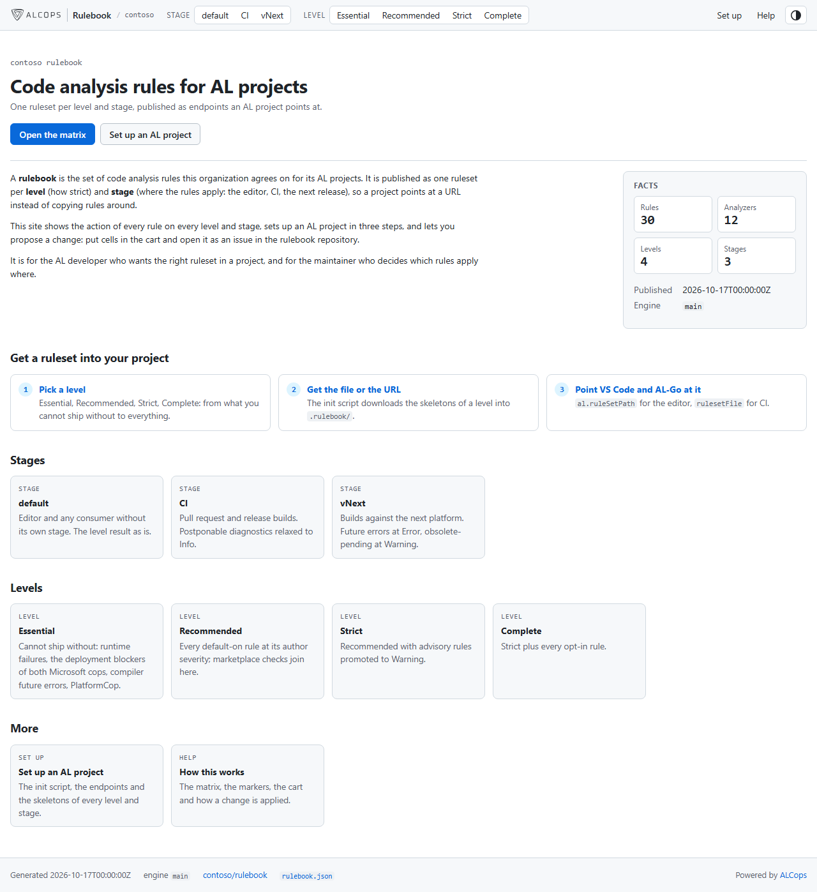 | 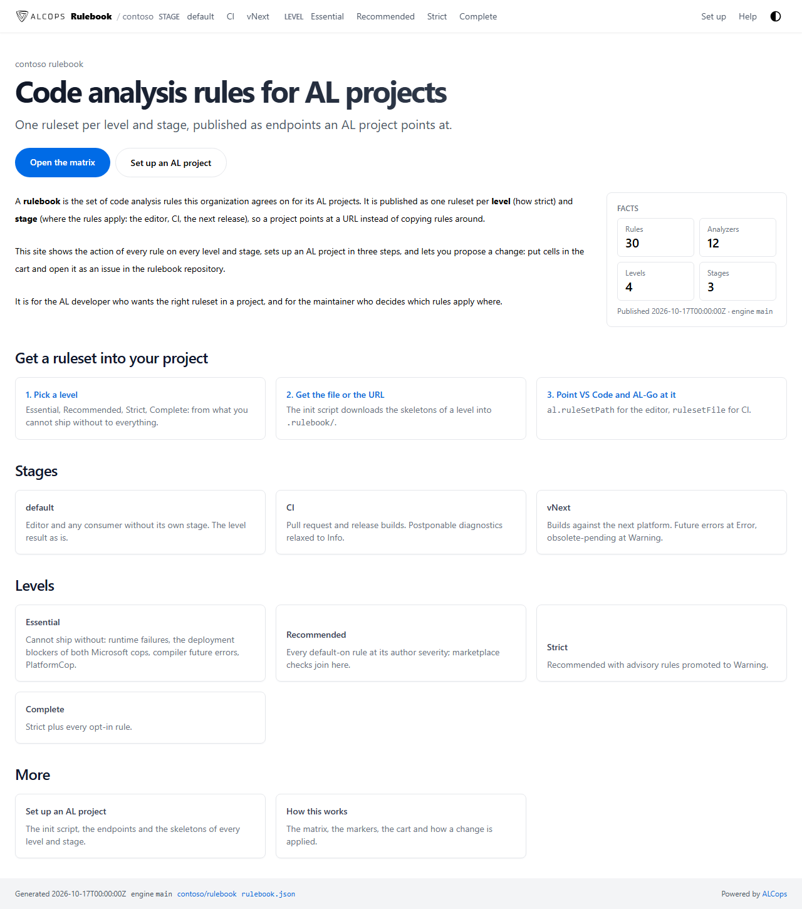 |
| `/` 1280 px, dark | 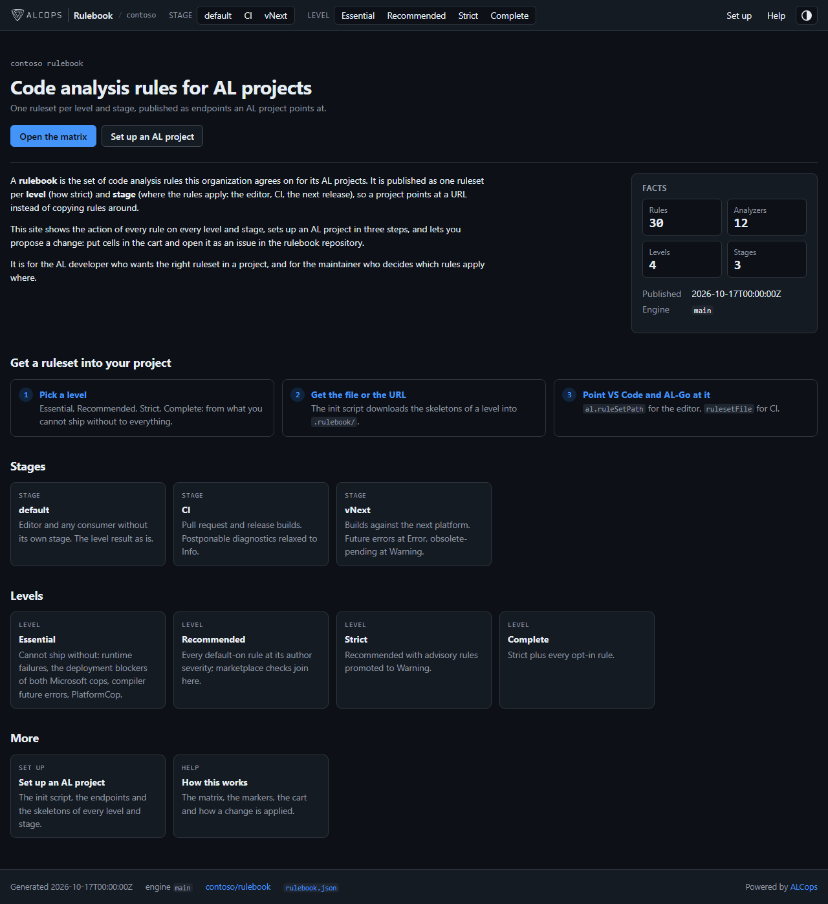 | 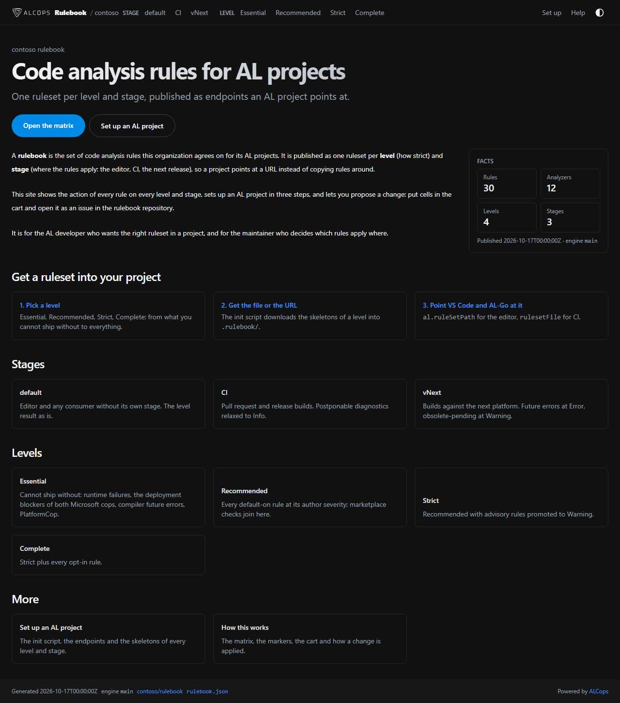 |
| `/` 390 px, light | 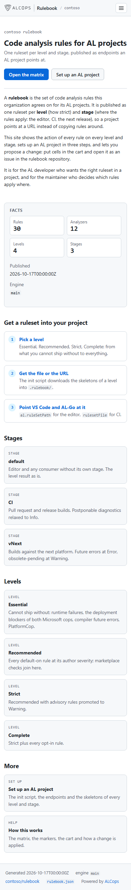 | 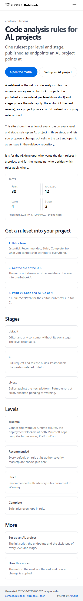 |
| `/` 390 px, dark | 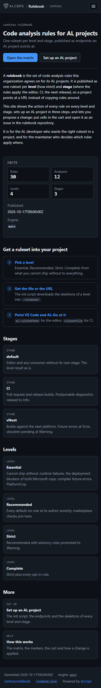 | 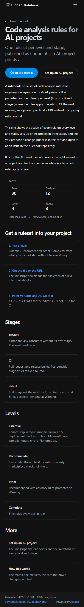 |
| `stages/default/` 1280 px, light | 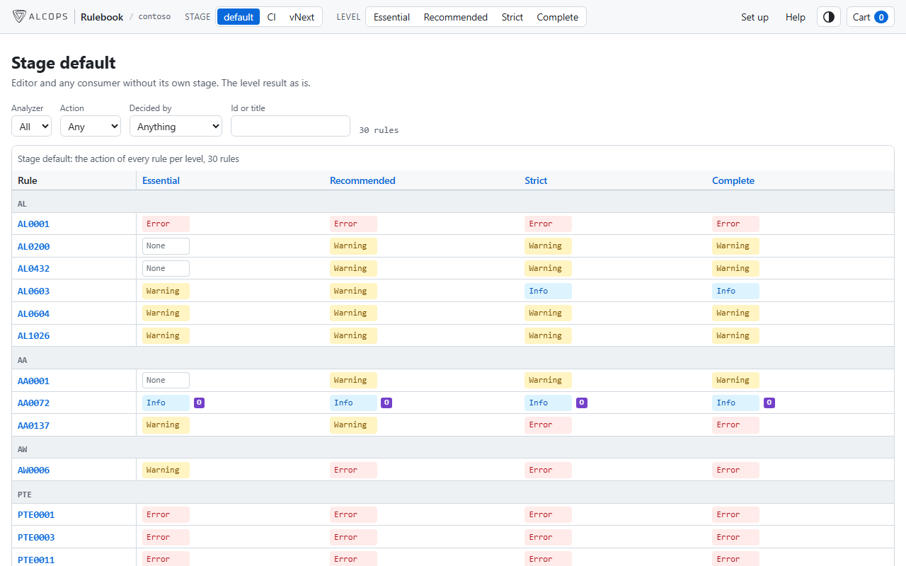 | 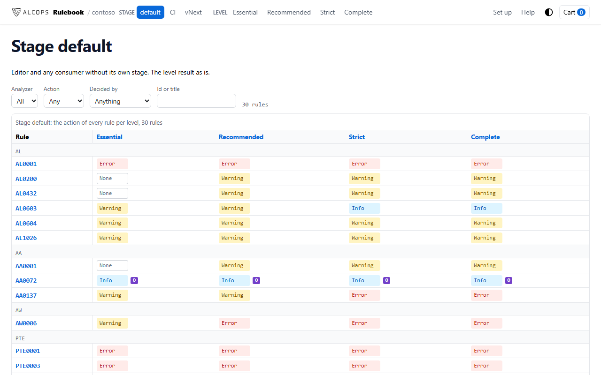 |
| `stages/default/` 1280 px, dark | 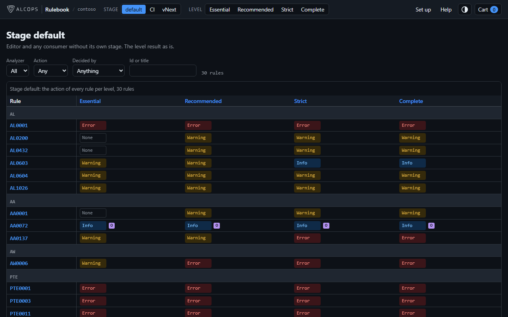 | 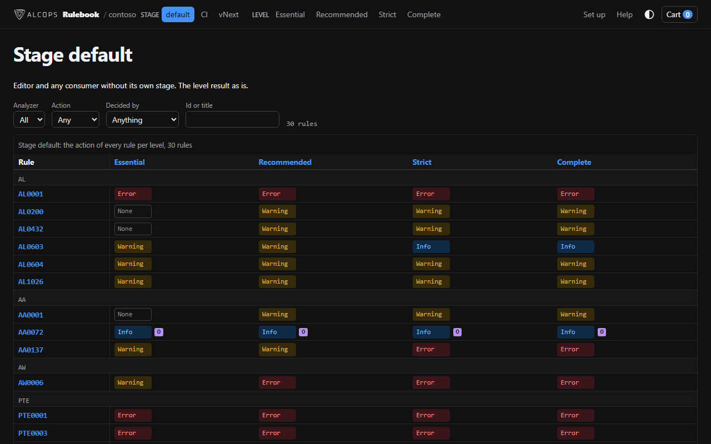 |
| `stages/default/` 390 px, light | 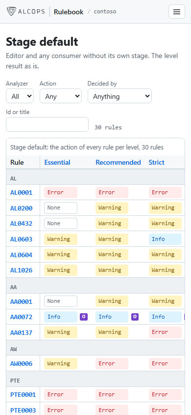 | 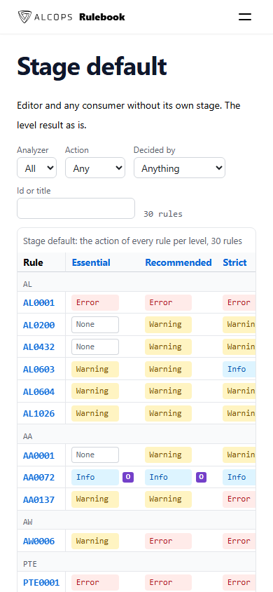 |
| `stages/default/` 390 px, dark | 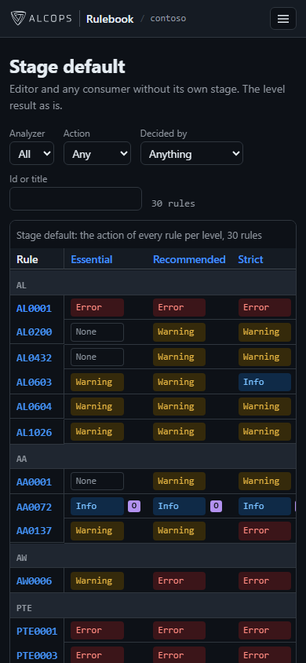 | 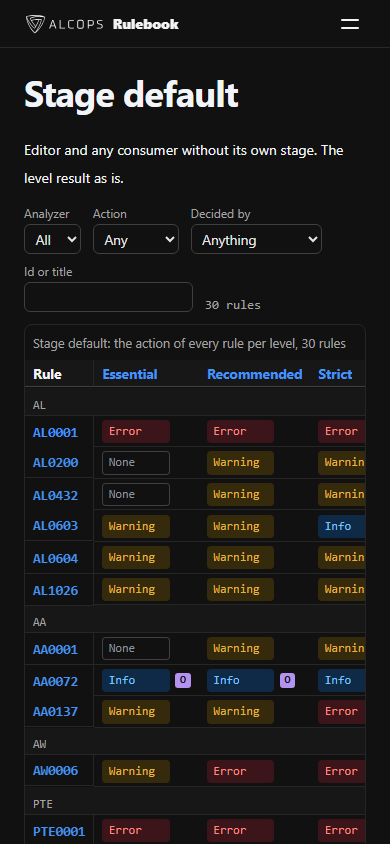 |

## Answer

Own CSS ([D59](../../../adr/0059-the-site-shell-is-own-css-and-no-vendored-theme.md)), chosen by the owner on 2026-10-28. Hextra passed every hard constraint of #136 after trimming:

- no `resources.GetRemote` left;
- the build runs offline;
- no CDN reference in the output;
- 12 files;
- no fight with the matrix.

But the theme contributed only its compiled CSS and a theme toggle. Its precompiled CSS limits later layouts to the classes Hextra itself uses. Its dark mode needs JavaScript. It adds 163,141 bytes to every organization repository, plus three trims to repeat on every Hextra release.

## Not covered

- **628 rows.** The fixture has 30 rules, so the sticky header row and rule column were checked on 30 rows, not on the 628 of the shipped template.
- **Hextra's own greys.** The contrast script measured the site tokens of both variants, not Hextra's utility greys (`hx:text-gray-500` and similar).
- **Other systems.** The local server and the browser checks ran on Windows only. There, `python -m http.server` serves `.mjs` as `text/plain`, so the browser refuses `cart.mjs` and the cart never appears; a local check needs a server that serves `.mjs` as `text/javascript` (a three-line `SimpleHTTPRequestHandler` subclass with `extensions_map` set).

## Notes for the shell PR (#138)

- **Chip markup.** Both variants wrap the action of a cell in `` and keep every `data-*` attribute. The cell pattern of `tests/Rulebook.Site.Tests.ps1` (around line 571, `tabindex="0">NoneNone/` instead of `/` and marks the landing page `<main data-rulebook-landing>`; the landing PR (#139) owns that change and its tests.
- **Footer link.** The footer hard-codes `https://alcops.dev` for "Powered by ALCops" until the `docs` map of `rulebook.json` carries `docs.home`.
- **Starting point.** The shell PR starts from `wp16/spike-own-css`. That branch has no tests, no Open Graph check and no favicon yet, and its `head.html` description fallback is a first cut.
